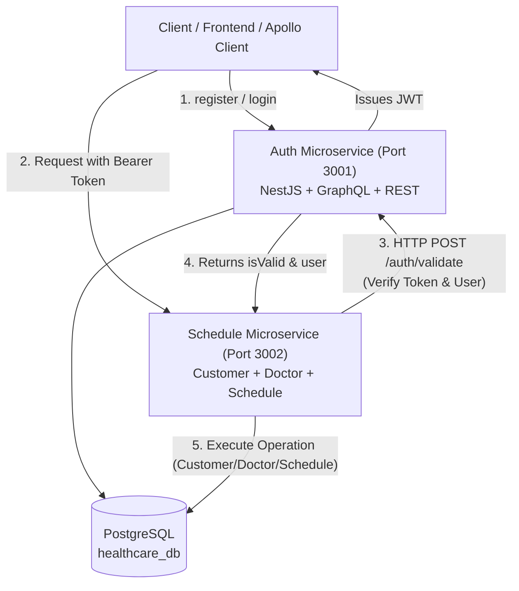

# Healthcare Scheduling System - Microservices Architecture

Sistem penjadwalan layanan kesehatan berbasis arsitektur **Microservices** modern menggunakan **NestJS**, **PostgreSQL**, **GraphQL (Apollo Server)**, **Prisma ORM**, dan **Docker & Docker Compose**.

Sistem ini terdiri dari 2 microservice utama yang saling terintegrasi:
1. **Auth Service (`port: 3001`)**: Manajemen akun pengguna, otentikasi (JWT), dan penyedia validasi token untuk seluruh ekosistem.
2. **Schedule Service (`port: 3002`)**: Manajemen Customer/Pasien, Dokter, dan Penjadwalan Konsultasi (*Appointment Scheduling*) dengan proteksi autentikasi antar service serta pencegahan jadwal bentrok (*conflict prevention*).

---

## 🏛️ 1. Arsitektur Sistem & Alur Autentikasi



### Mekanisme Autentikasi Antar Service:
1. Client mengirim request ke **Schedule Service** (Port 3002) dengan header:  
   `Authorization: Bearer <token>`
2. **Schedule Service** melalui `AuthGuard` memanggil endpoint REST **Auth Service** (Port 3001):  
   `POST http://auth-service:3001/auth/validate`
3. Jika token sah dan user aktif: Auth Service mengembalikan status `isValid: true` beserta data user, lalu request diproses.
4. Jika token tidak valid / kedaluwarsa / header tidak ada: Schedule Service langsung mengembalikan error **HTTP 401 Unauthorized**.

---

## 🔐 2. Ringkasan Modul & Aturan Bisnis

### A. Customer Module (`schedule-service`)
- `createCustomer(input)`: Membuat customer baru (nama dan email unik).
- `updateCustomer(input)`: Update data customer berdasarkan ID.
- `customers(pagination)`: Menampilkan daftar semua customer dengan pagination (`skip`, `take`, `total`).
- `customer(id)`: Mengambil detail customer berdasarkan ID.
- `deleteCustomer(id)`: Menghapus customer berdasarkan ID.

### B. Doctor Module (`schedule-service`)
- `createDoctor(input)`: Membuat dokter baru (nama lengkap beserta gelar).
- `updateDoctor(input)`: Update data dokter berdasarkan ID.
- `doctors(pagination)`: Menampilkan daftar dokter dengan pagination.
- `doctor(id)`: Mengambil detail dokter berdasarkan ID.
- `deleteDoctor(id)`: Menghapus dokter berdasarkan ID.

### C. Schedule Module (`schedule-service`)
- `createSchedule(input)`: Membuat jadwal konsultasi baru (`objective`, `customerId`, `doctorId`, `scheduledAt`).
- `schedules(filter, pagination)`: Menampilkan daftar jadwal dengan filter (`doctorId`, `customerId`, rentang tanggal `startDate` - `endDate`) dan pagination.
- `schedule(id)`: Mengambil jadwal lengkap dengan relasi data Customer dan Doctor.
- `deleteSchedule(id)`: Menghapus jadwal konsultasi.

#### ⚠️ Ketentuan Khusus Penjadwalan:
1. **Pencegahan Bentrok (*No Overlapping/Conflict*)**: Tidak boleh ada jadwal yang bentrok untuk dokter yang sama pada waktu yang sama. Jika dokter sudah memiliki jadwal pada jam tersebut, sistem akan melempar error **HTTP 409 Conflict**.
2. **Validasi Entitas**: Customer dan Doctor harus valid dan terdaftar di database sebelum jadwal dapat dibuat. Jika ID tidak ditemukan, sistem melempar error **HTTP 404 Not Found**.
3. **Autentikasi Penuh**: Semua endpoint membutuhkan token JWT yang valid dari Auth Service.

---

## 🔑 3. List Environment Variables

Semua data sensitif disimpan di file `.env` dan dilindungi oleh `.gitignore`. Template tersedia di [`.env.example`](file:///.env.example).

| Variable Name | Service | Default / Rekomendasi | Deskripsi & Keamanan |
| :--- | :---: | :--- | :--- |
| `POSTGRES_USER` | DB | `postgres` | Username database PostgreSQL. |
| `POSTGRES_PASSWORD` | DB | `postgres` | **Sensitif**. Password database PostgreSQL. |
| `POSTGRES_DB` | DB | `healthcare_db` | Database default saat PostgreSQL inisialisasi. |
| `AUTH_SERVICE_PORT` | Auth | `3001` | Port aplikasi Auth Service. |
| `JWT_SECRET` | Auth | *(Minimal 32 karakter)* | **Sangat Sensitif**. Kunci enkripsi untuk token JWT. |
| `JWT_EXPIRES_IN` | Auth | `1d` | Masa aktif token JWT (contoh: `1d` = 24 jam). |
| `SCHEDULE_SERVICE_PORT` | Schedule | `3002` | Port aplikasi Schedule Service. |
| `AUTH_SERVICE_URL` | Schedule | `http://auth-service:3001` | URL Auth Service untuk validasi token antar service. |
| `CORS_ORIGIN` | All | `*` / `http://localhost:3000` | Whitelist domain frontend yang diizinkan (CORS). |

---

## 🚀 4. Cara Menjalankan Project

### Opsi A: Menggunakan Docker Compose (Direkomendasikan)

Perintah ini akan membangun dan menjalankan PostgreSQL, Auth Service (3001), dan Schedule Service (3002) secara otomatis:

```bash
# 1. Jalankan semua service dengan Docker Compose
docker compose up -d --build

# 2. Cek status container
docker compose ps
```

**Port & URL yang Tersedia:**
- **Auth Service GraphQL Playground**: [http://localhost:3001/graphql](http://localhost:3001/graphql)
- **Schedule Service GraphQL Playground**: [http://localhost:3002/graphql](http://localhost:3002/graphql)
- **Schedule Service Health Check**: [http://localhost:3002/health](http://localhost:3002/health)

---

### Opsi B: Menjalankan Secara Lokal (Development Mode)

Pastikan PostgreSQL aktif di port 5432:

1. **Jalankan Auth Service (Port 3001):**
   ```bash
   cd auth-service
   cp .env.example .env
   npm run prisma:generate
   npm run prisma:push
   npm run start:dev
   ```

2. **Jalankan Schedule Service (Port 3002) di terminal terpisah:**
   ```bash
   cd schedule-service
   cp .env.example .env
   npm run prisma:generate
   npm run prisma:push
   npm run start:dev
   ```

3. **Menjalankan Automated Tests:**
   ```bash
   # Test Auth Service (46 tests)
   cd auth-service && npm test

   # Test Schedule Service (31 tests)
   cd schedule-service && npm test
   ```
   *Total: **77 Unit Tests** berjalan 100% lulus.*

---

## 📡 5. Contoh GraphQL Queries & Mutations

### A. Auth Service (`http://localhost:3001/graphql`)

#### 1. Register & Login
```graphql
mutation RegisterUser {
  register(input: {
    email: "fajar@test.com"
    password: "SecurePassword123!"
  }) {
    accessToken
    user { id email }
  }
}
```

---

### B. Schedule Service (`http://localhost:3002/graphql`)
> **Penting**: Semua request ke Schedule Service **harus menyertakan header HTTP**:  
> `Authorization: Bearer <MASUKKAN_ACCESS_TOKEN_DARI_AUTH_SERVICE>`

#### 1. Membuat Customer Baru
```graphql
mutation CreateCustomer {
  createCustomer(input: {
    name: "Teddy"
    email: "teddy@test.com"
  }) {
    id
    name
    email
    createdAt
  }
}
```

#### 2. Menampilkan Daftar Customer (Pagination)
```graphql
query GetCustomers {
  customers(pagination: { skip: 0, take: 10 }) {
    total
    skip
    take
    items {
      id
      name
      email
    }
  }
}
```

#### 3. Membuat Dokter Baru
```graphql
mutation CreateDoctor {
  createDoctor(input: {
    name: "Doctor Lukman"
  }) {
    id
    name
    createdAt
  }
}
```

#### 4. Menampilkan Daftar Dokter (Pagination)
```graphql
query GetDoctors {
  doctors(pagination: { skip: 0, take: 10 }) {
    total
    skip
    take
    items {
      id
      name
    }
  }
}
```

#### 5. Membuat Jadwal Konsultasi Baru (`createSchedule`)
```graphql
mutation CreateSchedule {
  createSchedule(input: {
    objective: "Consultation between Doctor Lukman and Customer Teddy"
    customerId: "<CUSTOMER_UUID>"
    doctorId: "<DOCTOR_UUID>"
    scheduledAt: "2026-12-01T09:00:00.000Z"
  }) {
    id
    objective
    scheduledAt
    customer {
      name
      email
    }
    doctor {
      name
    }
  }
}
```

#### 6. Menguji Pencegahan Bentrok (*Conflict Prevention*)
Jika Anda mengeksekusi mutasi jadwal di atas dengan `doctorId` dan `scheduledAt` yang sama:
```json
{
  "errors": [
    {
      "message": "Doctor already has an appointment scheduled at 2026-12-01T09:00:00.000Z",
      "extensions": {
        "code": "CONFLICT"
      }
    }
  ]
}
```

#### 7. Menampilkan Daftar Jadwal dengan Filter & Pagination
```graphql
query GetFilteredSchedules {
  schedules(
    filter: {
      doctorId: "<DOCTOR_UUID>"
      startDate: "2026-12-01T00:00:00.000Z"
      endDate: "2026-12-31T23:59:59.000Z"
    }
    pagination: { skip: 0, take: 10 }
  ) {
    total
    items {
      id
      objective
      scheduledAt
      customer {
        name
      }
      doctor {
        name
      }
    }
  }
}
```

---

## 📬 6. Postman Collection

File Postman Collection lengkap disediakan di:  
[`Healthcare Scheduling System - Auth Service.postman_collection.json`](file:///Healthcare%20Scheduling%20System%20-%20Auth%20Service.postman_collection.json)

### Fitur Otomatisasi Postman:
1. **Otomatisasi Token**: Saat menjalankan request `Register User` atau `Login User` di Auth Service, token otomatis tersimpan ke variabel `{{auth_token}}`.
2. **Otomatisasi ID Relasi**:
   - Menjalankan `Create Customer` otomatis menyimpan ID ke `{{customer_id}}`.
   - Menjalankan `Create Doctor` otomatis menyimpan ID ke `{{doctor_id}}`.
   - Menjalankan `Create Schedule` otomatis menggunakan `{{customer_id}}` dan `{{doctor_id}}` tanpa perlu copy-paste manual!
3. **Pengujian Bentrok Terpasang**: Terdapat request *Create Conflicting Schedule* untuk membuktikan penolakan jadwal bentrok secara otomatis.