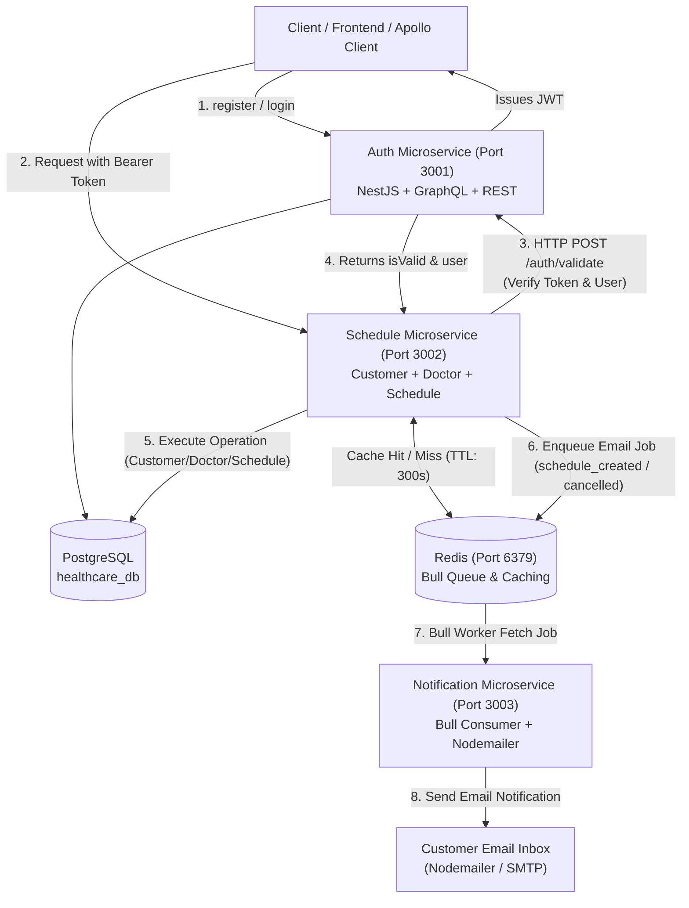

# Healthcare Scheduling System - Microservices Architecture

Sistem penjadwalan layanan kesehatan berbasis arsitektur **Microservices** modern menggunakan **NestJS**, **PostgreSQL**, **GraphQL (Apollo Server)**, **Prisma ORM**, **Redis (Bull Queue & Caching)**, **Nodemailer**, dan **Docker & Docker Compose**.

Sistem ini terdiri dari 3 microservice utama dan 2 infrastruktur pendukung yang saling terintegrasi:
1. **Auth Service (`port: 3001`)**: Manajemen akun pengguna, otentikasi (JWT), dan penyedia validasi token untuk seluruh ekosistem.
2. **Schedule Service (`port: 3002`)**: Manajemen Customer/Pasien, Dokter, dan Penjadwalan Konsultasi (*Appointment Scheduling*) dengan proteksi autentikasi antar service, pencegahan jadwal bentrok (*conflict prevention*), dan optimasi **Redis Caching**.
3. **Notification Service (`port: 3003`)**: Layanan pemroses antrean (Bull Queue) yang menangani pengiriman email notifikasi otomatis ke customer saat jadwal dibuat atau dibatalkan.
4. **PostgreSQL (`port: 5432`)**: Single database terpadu (`healthcare_db`) untuk seluruh microservice.
5. **Redis (`port: 6379`)**: Broker pesan untuk Bull Queue dan memori berkecepatan tinggi untuk query caching.

---

##  1. Arsitektur Sistem & Alur Kerja



### Mekanisme Autentikasi Antar Service:
1. Client mengirim request ke **Schedule Service** (Port 3002) dengan header:  
   `Authorization: Bearer <token>`
2. **Schedule Service** melalui `AuthGuard` memanggil endpoint REST **Auth Service** (Port 3001):  
   `POST http://auth-service:3001/auth/validate`
3. Jika token sah dan user aktif: Auth Service mengembalikan status `isValid: true` beserta data user, lalu request diproses.
4. Jika token tidak valid / kedaluwarsa / header tidak ada: Schedule Service langsung mengembalikan error **HTTP 401 Unauthorized**.

---

##  2. Ringkasan Modul & Fitur Sistem

### A. Customer Module (`schedule-service`)
- `createCustomer(input)`: Membuat customer baru (nama dan email unik). Menginvalidasi cache daftar customer.
- `updateCustomer(input)`: Update data customer berdasarkan ID. Menginvalidasi cache.
- `customers(pagination)`: Menampilkan daftar semua customer dengan paginasi (`skip`, `take`, `total`) serta **Redis Caching** (TTL: 300s).
- `customer(id)`: Mengambil detail customer berdasarkan ID dengan **Redis Caching**.
- `deleteCustomer(id)`: Menghapus customer berdasarkan ID dan membersihkan cache.

### B. Doctor Module (`schedule-service`)
- `createDoctor(input)`: Membuat dokter baru (nama lengkap beserta gelar). Menginvalidasi cache daftar dokter.
- `updateDoctor(input)`: Update data dokter berdasarkan ID. Menginvalidasi cache.
- `doctors(pagination)`: Menampilkan daftar dokter dengan paginasi serta **Redis Caching** (TTL: 300s).
- `doctor(id)`: Mengambil detail dokter berdasarkan ID dengan **Redis Caching**.
- `deleteDoctor(id)`: Menghapus dokter berdasarkan ID dan membersihkan cache.

### C. Schedule Module (`schedule-service`)
- `createSchedule(input)`: Membuat jadwal konsultasi baru (`objective`, `customerId`, `doctorId`, `scheduledAt`).
  - Memicu job antrean email konfirmasi ke Bull Queue.
  - Menginvalidasi cache jadwal konsultasi.
- `schedules(filter, pagination)`: Menampilkan daftar jadwal dengan filter (`doctorId`, `customerId`, rentang tanggal `startDate` - `endDate`) dan paginasi dengan **Redis Caching**.
- `schedule(id)`: Mengambil jadwal lengkap dengan relasi data Customer dan Doctor dengan **Redis Caching**.
- `deleteSchedule(id)`: Menghapus jadwal konsultasi.
  - Memicu job antrean email pembatalan ke Bull Queue.
  - Menginvalidasi cache jadwal terkait.

### D. Redis Caching System (`schedule-service`)
- Menggunakan pola **Cache-Aside Pattern** berkecepatan tinggi via **Redis** (`ioredis`).
- **Query Optimization**: Data query (`customers`, `doctors`, `schedules`, dan pencarian by ID) disimpan di Redis dengan TTL default 300 detik (5 menit).
- **Cache Invalidation**: Setiap ada mutasi (`create`, `update`, `delete`), cache terkait otomatis dihapus (*purged*) secara presisi agar data tetap konsisten (*eventually consistent*).

### E. Notification Microservice & Bull Queue (`notification-service`)
- Beroperasi secara independen di **Port 3003** sebagai *Bull Queue Consumer*.
- Mengambil job `schedule_created` dan `schedule_cancelled` dari antrean `mail_queue` di Redis.
- Mengirimkan email responsif berbasis HTML dan teks menggunakan **Nodemailer** ke email customer (`teddy@test.com`).
- Menyediakan riwayat pengiriman notifikasi yang dapat diinspeksi melalui GraphQL query `notificationLogs` dan health check `notificationHealth`.

---

## 3. API Documentation & GraphQL Playground

Seluruh microservice dilengkapi dengan **GraphQL Playground / Apollo Sandbox** yang memiliki dokumentasi skema lengkap, deskripsi tipe data (*ObjectType*), parameter input (*InputType*), argumen (*Args*), serta query dan mutasi dalam bahasa Indonesia dan Inggris.

| Service | Port | GraphQL Playground URL | Health Check REST URL |
| :--- | :---: | :--- | :--- |
| **Auth Service** | `3001` | [http://localhost:3001/graphql](http://localhost:3001/graphql) | [http://localhost:3001/health](http://localhost:3001/health) |
| **Schedule Service** | `3002` | [http://localhost:3002/graphql](http://localhost:3002/graphql) | [http://localhost:3002/health](http://localhost:3002/health) |
| **Notification Service** | `3003` | [http://localhost:3003/graphql](http://localhost:3003/graphql) | [http://localhost:3003/health](http://localhost:3003/health) |

Fitur GraphQL Introspection dan Playground aktif secara *out-of-the-box*, memungkinkan tim frontend atau penguji API melihat struktur field, dokumentasi parameter, dan melakukan *live query* langsung dari browser.

---

## 4. List Environment Variables

Semua data sensitif disimpan di file `.env` dan dilindungi oleh `.gitignore`. Template tersedia di [`.env.example`](file:///.env.example).

| Variable Name | Service | Default / Rekomendasi | Deskripsi & Keamanan |
| :--- | :---: | :--- | :--- |
| `POSTGRES_USER` | DB | `postgres` | Username database PostgreSQL. |
| `POSTGRES_PASSWORD` | DB | `postgres` | **Sensitif**. Password database PostgreSQL. |
| `POSTGRES_DB` | DB | `healthcare_db` | Database default saat PostgreSQL inisialisasi. |
| `REDIS_HOST` | Queue & Cache | `redis` / `localhost` | Hostname Redis untuk Bull Queue & Caching. |
| `REDIS_PORT` | Queue & Cache | `6379` | Port server Redis. |
| `AUTH_SERVICE_PORT` | Auth | `3001` | Port aplikasi Auth Service. |
| `JWT_SECRET` | Auth | *(Minimal 32 karakter)* | **Sangat Sensitif**. Kunci enkripsi untuk token JWT. |
| `JWT_EXPIRES_IN` | Auth | `1d` | Masa aktif token JWT (contoh: `1d` = 24 jam). |
| `SCHEDULE_SERVICE_PORT` | Schedule | `3002` | Port aplikasi Schedule Service. |
| `AUTH_SERVICE_URL` | Schedule | `http://auth-service:3001` | URL Auth Service untuk validasi token antar service. |
| `NOTIFICATION_SERVICE_PORT` | Notification | `3003` | Port aplikasi Notification Service. |
| `SMTP_HOST` | Mail | *(Opsional)* | Host server SMTP (kosongkan untuk JSON fallback transporter). |
| `SMTP_PORT` | Mail | `587` | Port server SMTP. |
| `SMTP_USER` | Mail | *(Opsional)* | Username autentikasi SMTP. |
| `SMTP_PASS` | Mail | *(Opsional)* | Password autentikasi SMTP. |
| `SMTP_FROM` | Mail | `noreply@healthcare.com` | Alamat pengirim email sistem. |
| `CORS_ORIGIN` | All | `*` / `http://localhost:3000` | Whitelist domain frontend yang diizinkan (CORS). |

---

## 5. Cara Menjalankan Project

### Opsi A: Menggunakan Docker Compose (Sangat Direkomendasikan)

Perintah ini akan membangun dan menjalankan PostgreSQL, Redis, Auth Service (3001), Schedule Service (3002), dan Notification Service (3003) secara otomatis:

```bash
# 1. Jalankan semua container di latar belakang
sudo docker compose up -d --build

# 2. Periksa status seluruh container
sudo docker compose ps
```

Container:
- `healthcare_postgres` (PostgreSQL 16)
- `healthcare_redis` (Redis 7)
- `healthcare_auth_service` (Auth Service - Port 3001)
- `healthcare_schedule_service` (Schedule Service - Port 3002)
- `healthcare_notification_service` (Notification Service - Port 3003)

---

## 6. Postman Collection

File Postman Collection lengkap disediakan di root direktori:  
[`Healthcare Scheduling System - Auth Service.postman_collection.json`](file:///Healthcare%20Scheduling%20System%20-%20Auth%20Service.postman_collection.json)

### Fitur Otomatisasi Postman:
1. **Otomatisasi Token**: Saat menjalankan request `Register User` atau `Login User` di Auth Service, token otomatis tersimpan ke variabel `{{auth_token}}`.
2. **Otomatisasi ID Relasi**:
   - Menjalankan `Create Customer` otomatis menyimpan ID ke `{{customer_id}}`.
   - Menjalankan `Create Doctor` otomatis menyimpan ID ke `{{doctor_id}}`.
   - Menjalankan `Create Schedule` otomatis menggunakan `{{customer_id}}` dan `{{doctor_id}}` tanpa perlu copy-paste manual.
3. **Pengujian Bentrok Terpasang**: Terdapat request *Create Conflicting Schedule* untuk membuktikan penolakan jadwal bentrok secara otomatis (HTTP 409).
